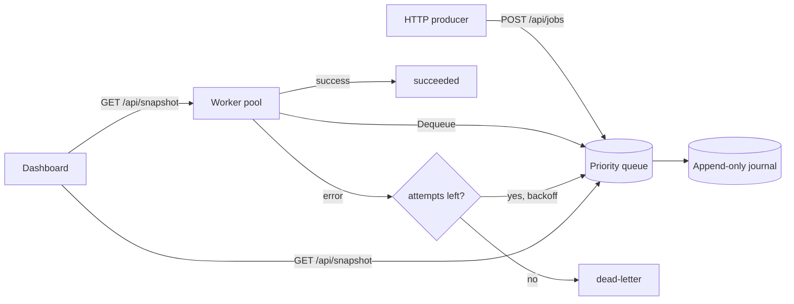

# TickFlow


**A durable background-job engine in Go — retries, exponential backoff, scheduling, and a live dashboard.**

TickFlow is a self-hosted alternative to Sidekiq/Celery/managed queues for teams that live in Go. Producers enqueue jobs over HTTP; a pool of workers executes typed handlers with **at-least-once** delivery, automatic retries with exponential backoff, priority ordering, and future scheduling. Everything is persisted to an append-only journal, so a restart never loses in-flight work. It runs as one small container on **AWS ECS/Fargate**.

> Why it exists: a small event venue sells tickets online. Each sale enqueues a `send_ticket_email` job. If the mail provider hiccups, TickFlow retries with backoff and only dead-letters after exhausting attempts — so no customer silently misses their ticket. The same engine also runs nightly sales reports and reminder emails.

---

## What makes it interesting (engineering)

- **Priority + time-ordered queue** built on a `container/heap` (`internal/queue/pqueue.go`): jobs are dispatched by earliest `RunAt`, then by priority.
- **Exponential backoff + dead-letter**: failures reschedule with `1s, 2s, 4s…` (capped), and exhausted jobs move to a dead set instead of looping forever.
- **Durability via an append-only journal** with replay on startup — verified live by killing and restarting the process.
- **Crash-safe workers**: handler panics are recovered and converted to retryable errors; each job runs under a timeout so one stuck handler can't wedge a worker.
- **Typed handler registry**: add a new job type by registering one function — emails, PDFs, webhooks all flow through the same retry-aware pipeline.
- **Tested** under `-race`: full lifecycle, retry→dead-letter, priority ordering, and scheduled-job gating.

## Architecture



## Quick start

```bash
docker compose up --build
```

Open http://localhost:8081 and click **Sell 20 tickets (burst)**. Watch jobs flow `pending → running → succeeded`, with ~35% hitting simulated failures and retrying with backoff. Click **Schedule reminder (+5s)** to see time-based scheduling.

## API

| Method | Path | Description |
|--------|------|-------------|
| `POST` | `/api/jobs` | Enqueue `{type, payload, priority, max_attempts, delay_secs}` |
| `GET`  | `/api/snapshot` | Queue counts, recent jobs, and worker metrics |

Example:

```bash
curl -X POST localhost:8081/api/jobs -H 'Content-Type: application/json' -d '{
  "type": "send_ticket_email",
  "priority": 5,
  "max_attempts": 5,
  "payload": {"to": "fan@example.com", "event_id": "night-01"}
}'
```

## Run locally without Docker

```bash
go build -o tickflow ./cmd/tickflow
./tickflow --http :8081 --workers 4 --journal ./tickflow.journal
```

Kill it mid-run and restart — the journal replays and in-flight jobs resume.

## Tests

```bash
go test ./... -race
```

## Development

Common tasks are wrapped in a `Makefile` (`make help` lists everything):

```bash
make check            # lint (vet + gofmt) and run tests with the race detector
make race             # tests under the race detector
make run              # run the service locally
make frontend-dev     # Vite dev server for the React/TS dashboard
make up               # docker compose up --build
```

## Deploying to AWS ECS/Fargate

1. Push the image to ECR.
2. Mount an **EFS volume** at `/data` so the journal is durable across restarts/redeploys.
3. Scale workers with `--workers`; run multiple tasks for throughput (each task is an independent worker pool over its own journal, or point them at a shared store as a next step).
4. Front the dashboard/API with an ALB.

## Project layout

```
cmd/tickflow        entrypoint + demo handlers
internal/queue      durable priority queue, backoff, journal
internal/worker     worker pool, handler registry, panic recovery
internal/api        HTTP submit + snapshot
web/static          live dashboard (Tailwind CDN)
```

## License

MIT
